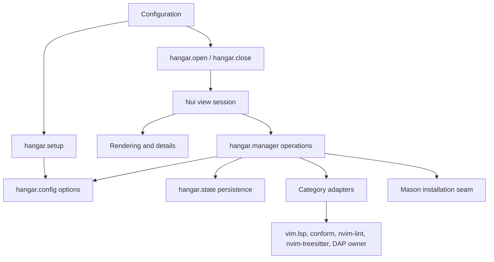

# Architecture

`hangar.config` validates the options, fills defaults and completes the registry. Every module reads the registry, paths, view options and adapter owners from it per call. No module requires a module of the configuration that uses hangar.

`hangar.manager` accepts category, logical tool name and optional filetype. It checks capabilities and the adapter's `unavailable()` before a state change or an installation. Snapshots contain status, health and groups without Nui nodes or cursor coordinates. `busy()` reports pending toggles, Mason installs and category installs. Setup uses it to refuse replacement.

`hangar.state` reads current or legacy JSON. A write locks the file and reads the current disk state again before it merges one change. `hangar.order` reconciles saved order with current candidates. Category adapters translate aliases through `runtime_name` at the runtime boundary. They keep unrelated backend entries and conform option keys. When formatters and linters are enabled again, they obey the activation. They do not activate all supported filetypes.

`hangar.activation` owns the formatter and linter activation for the session. Injected activation wins and replaces the session list. Otherwise the list recorded by `hangar.filter` is used, or a capture of the backend lists. A captured list merges names that the live backend gains. Setup keeps the session list, because the backend still holds the lists that hangar changed. `hangar.order` uses this activation as the default priority. It reads activation before the first reorder, too.

`hangar.ui.view` owns layout, source context, selection, mappings, subscriptions, timers and details for one session. Render and details modules produce its content. Icons, the border, mappings and help come from the options.

An asynchronous operation can outlive the view. On completion, it updates state and runtime. Then it refreshes only the session that started it, if that session is still open. See the [guide](guide.md) for user-visible behavior.

`hangar.util` holds the text and atomic-write helpers, so hangar needs no helper library.

`doc/hangar.txt` is generated. `scripts/doc.lua` runs mini.doc on the annotation blocks of `init.lua` and `config.lua` that have a `@tag`. Other annotations stay code comments. `just doc-check` fails when the tracked help differs from a new generation or has an invalid tag.
