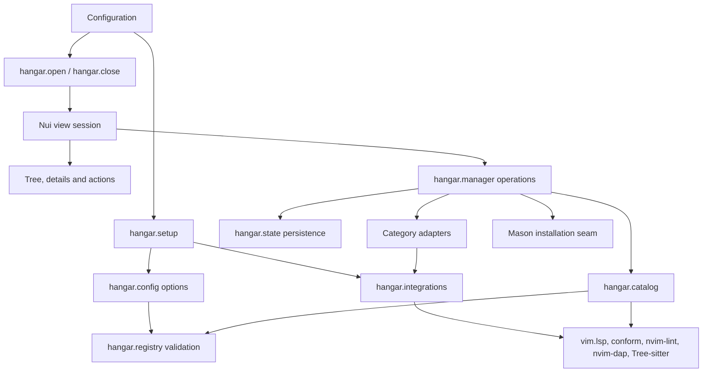

# Architecture

`hangar.config` validates the options, fills defaults and completes the registry. `hangar.registry` declares the registry types and rejects an unknown key, field or value with a path-named error. Every module reads the registry, paths, view options and integration switches from `hangar.config` per call. No module requires a module of the configuration that uses hangar.

`hangar.catalog` lists the tools of a category: the registry entries merged with the tools that loaded backends report. A registry field wins over a discovered one. Discovery never loads a backend.

`hangar.integrations` applies the integrations at setup. One module loader runs the conform, nvim-lint and nvim-dap integrations when `require` returns that plugin. `hook` wraps a plugin function once, so a repeated setup never stacks wrappers. The LSP and Tree-sitter integrations need no loader: they wrap `vim.lsp.enable` and own the `LspAttach` and `FileType` groups. Each integration reads saved state per call.

`hangar.manager` accepts category, logical tool name and optional filetype. It checks capabilities and the adapter's `unavailable()` before a state change or an installation. `data.snapshot` builds the read model: status, health and groups without Nui nodes or cursor coordinates. `busy()` reports pending toggles, Mason installs and category installs. Setup uses it to refuse replacement.

`hangar.state` reads JSON from the configured state file. A write locks the file and reads the current disk state again before it merges one change. `hangar.order` reconciles saved order with current candidates. Category adapters translate aliases through `runtime_name` at the runtime boundary and call the integrations for runtime changes. They keep unrelated backend entries and conform option keys. When formatters and linters are enabled again, they obey the activation. They do not activate all supported filetypes.

`hangar.activation` owns the formatter and linter activation for the session. The list recorded by `hangar.filter` wins. Otherwise the conform and lint integrations adopt each new backend table and filter it in place. Without either, a capture of the backend lists is used. A weak set marks the entries that hangar wrote, so no list is filtered twice. Setup keeps the session list, because the backend still holds the lists that hangar changed. `hangar.order` uses this activation as the default priority.

`hangar.ui.view` owns layout, source context, selection, mappings, subscriptions, timers and details for one session. These modules produce its content:

| Module | Role |
| --- | --- |
| `hangar.ui.tree` | Body tree of the selected category |
| `hangar.ui.render` | Column widths, padding and toggle support |
| `hangar.ui.geometry` | Window frames and the details layout |
| `hangar.ui.details` | Details window |
| `hangar.ui.details_content` | Details text of the selected node |
| `hangar.ui.actions` | Mapping actions |

Icons, the border, mappings and help come from the options.

An asynchronous operation can outlive the view. On completion, it updates state and runtime. Then it refreshes only the session that started it, if that session is still open. See the [guide](guide.md) for user-visible behavior.

`hangar.util` holds the text and atomic-write helpers, so hangar needs no helper library.

`doc/hangar.txt` is generated. `scripts/doc.lua` runs mini.doc on the annotation blocks of `init.lua`, `config.lua` and `registry.lua` that have a `@tag`. Other annotations stay code comments. `just doc-check` fails when the tracked help differs from a new generation or has an invalid tag.

The test runner `scripts/tests/run_suite.lua` runs each spec in a child Neovim and reports through telemetry.lua. A child fails on a failed, skipped or missing result.
